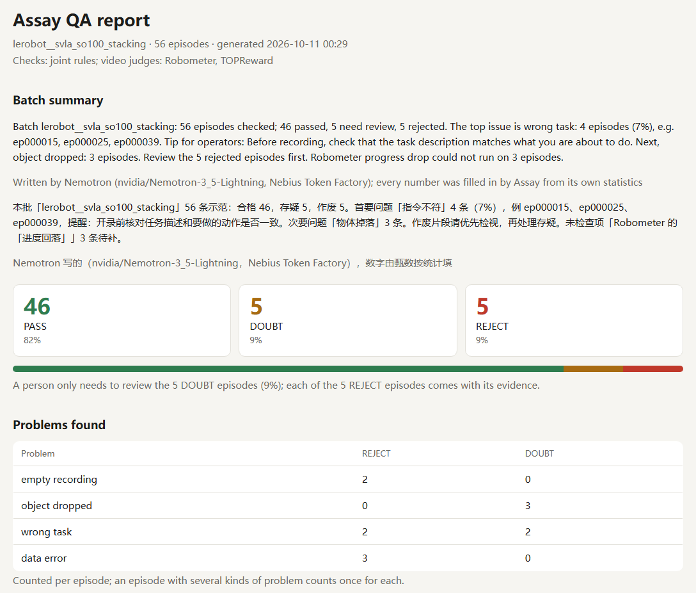
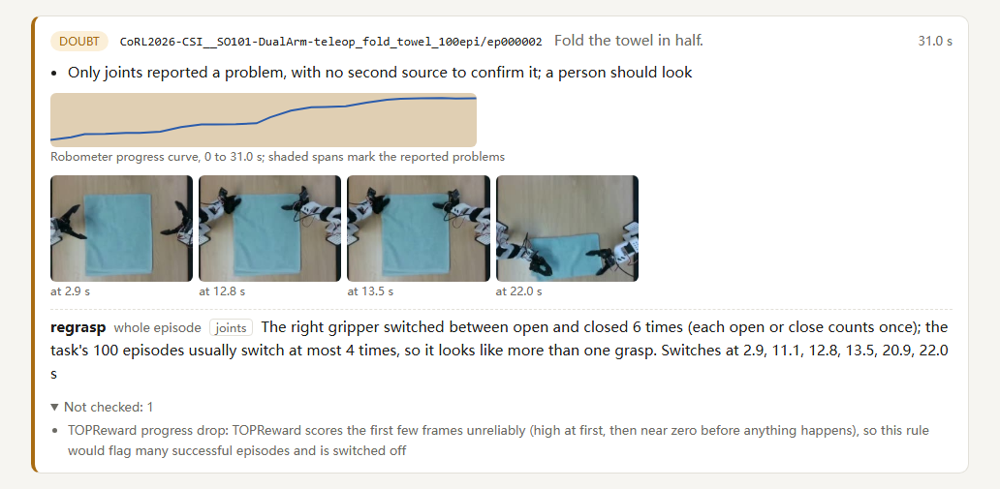

# Assay (甄数)

*Developed under the code name jianjin (拣金); the design notes and plans in `docs/` still use that name.*

[中文](README.zh-CN.md)

Automatic quality control for robot teleoperation demonstrations. For every recorded episode, Assay returns PASS, DOUBT or REJECT and says why: the problem, the evidence and, where the problem is local, when it happens (a time span, or for a regrasp the times the gripper switched). QA reviewers only look at the episodes the machine is unsure about, and every rejection comes with evidence. The joint checks run on a local CPU; the video judges need a GPU (so far we ran them on Colab and cached the results), and the report is a single HTML file that opens offline.

- **Public demonstration datasets are not clean.** In 308 episodes from five public LeRobot datasets, none marked as failed, Assay rejected 6, and all 6 are unusable: under one second, an arm that never moves, a person resetting the scene. It sent 33 more to a person: 12 are real problems, 12 false positives, 9 not checked yet.
- **It holds up on real QA labels.** RoboMIND published 1,678 episodes that Beijing Humanoid's QA team rejected, with the reason. Of the 162 regrasp rejections Assay can compare, the regrasp rule flags 99 (61%), with parameters chosen on another dataset and not retuned.
- **NVIDIA Nemotron on Nebius Token Factory** writes the batch summary with placeholders, and Assay fills in every number; any digit the model writes itself is rejected.



*The top of the English report for 56 cube-stacking episodes. The batch summary was written by Nemotron on Nebius Token Factory; every number in it was filled in by Assay.*



*One episode card. The right gripper switched between open and closed 6 times, where this task usually switches at most 4 times. The keyframes are taken at the switch times; two of them, open at 12.8 s and closed at 13.5 s, match the video: the gripper loses the towel corner at 12.9 s and grabs it again at 13.6 s.*

Entered in the Nebius × NVIDIA Global AI Hackathon (Physical AI track) and the first Haichuang π embodied-AI competition (首届「海创π」具身智能专项赛).

## Try it in two minutes

```bash
git clone https://github.com/hoongyu/assay && cd assay
uv sync
uv run --extra hub assay fetch exam_a   # the public LeRobot datasets of exam A, joint data only (about 73 MB)
uv run assay check data/lerobot__svla_so100_stacking --lang en --out report.html
```

Open `report.html` in a browser. Without a GPU only the joint checks run, and they already flag 5 of the 56 episodes: three recordings shorter than one second (rejected) and two where the arm never moves (doubt). We checked all five on video; all five are real problems. Drop `--lang en` for the Chinese interface; our first users are collection sites in China.

## Why

Embodied-AI training data is mostly collected by teleoperation: an operator drives a leader arm, the robot follows, and video and joint data are recorded. China has built dedicated data-collection sites for this: at least 15 large ones according to a count by China Business Journal, typically with a hundred or more robots each. Beijing Humanoid's site has over 120 robots, can produce over 100,000 hours a year, and sells data at 500 to 1,000 CNY per hour. QA and labeling still rely largely on manual work; the head of one large site estimated that of 100 hours collected, maybe 50 come out of the funnel usable (an estimate, not an industry statistic), and a data-company executive said collected data often falls short of what algorithm teams need. Whether rejection reasons reach the operators is not reported; our guess is that they rarely do, so the same mistakes repeat on the next shift. Sources and how we checked them: [background notes (Chinese)](docs/research/2026-10-02-background.md).

Assay does two things:

1. The machine screens every episode first; people only review what it is unsure about.
2. It says why: which second, which kind of problem, aggregated per operator for shift feedback.

## How it judges

| Looks at | Checks | Reports | Needs |
|---|---|---|---|
| Metadata and joint readings | Missing readings; dropped or out-of-order timestamps; too short; video shorter than joint data | Data error (objective hard rule: one is enough to reject) | CPU |
| Metadata | Video longer than joint data | Data error (doubt) | CPU |
| Joints | Stands still too long mid-episode | Long pause | CPU |
| Joints, compared with the other episodes of the same task | Path far longer than usual; end pose unlike a finished task; arm barely moves; gripper opens and closes more than usual; takes far longer than usual | Extra motion, incomplete, empty recording, regrasp, unsmooth motion | CPU |
| Video judge: Robometer-4B, zero-shot | Progress over the episode far below the batch; progress suddenly drops | Wrong task, object dropped | GPU, cached |
| Video judge: TOPReward (wraps Qwen3-VL-4B), zero-shot | Asks the model whether the robot completed the task; the probability of "yes" is far below the batch | Wrong task | GPU, cached |
| NVIDIA Nemotron on Nebius Token Factory (optional) | Writes the batch summary for the QA lead and the operators, in Chinese and English | Nothing: it never judges | API call |

Verdicts are conservative by choice: a rejection needs strong evidence, so good episodes are rarely thrown away. The price is that some bad episodes pass; on the RoboVAD test set, 140 of 387 anomalous episodes got PASS.

- **REJECT**: an objective hard rule fires, or two independent sources (the joint rules count as one, each video model as one) point at the same problem, for example both video models report the same wrong task.
- **DOUBT**: something was found, but not enough to reject; a person should look.
- **PASS**: nothing was found. Checks that could not run (no video, too few episodes of the task, a batch whose end poses vary anyway) are listed separately and never count as passed.

The report shows the verdict funnel for the batch, the problem distribution, per-operator statistics when the data carries operator ids, and one card per episode with the reasons, the progress curve, the flagged time span and keyframes (for a regrasp, taken at the gripper's switch times). `--lang en` writes the whole report in English: every piece of evidence is generated in both languages from the same numbers, without a model.

## Results

Thresholds are chosen on development data; test sets are only used to report. Where we looked at a test set more than once, we say so. Brackets are 95% Wilson intervals. Full record: [design doc (Chinese)](docs/superpowers/specs/2026-10-02-jianjin-design.md), section 6.

### Bad episodes hidden in public demonstration datasets

Five public LeRobot datasets (SO-100, SO-101, single-arm and bimanual), 308 episodes, published for training with no episode marked as failed (the dataset cards say nothing about quality). Assay flagged 39: 6 REJECT and 33 DOUBT (11%).

- **REJECT, all 6 are real problems**: 3 recordings shorter than one second; 2 where the arm never moves (one on video: 14 seconds of a motionless arm, then a human hand in the last frame; one from joint data, with the video model agreeing); 1 recording of a person resetting the cubes. Five of the six were checked on video.
- **DOUBT, 33**:
  - Real problems, 12: 9 whose video runs longer than the joint data, by 0.1 to 8.1 s (the two we watched show the towel being reset); 1 more where the arm never moves (joint data only); 1 that stops while the arm is still returning; 1 towel fold where the right gripper loses the corner and grasps again (RoboMIND calls this a regrasp).
  - False positives, 12, confirmed on video: cubes stacked so neatly that the lower one is hidden, an arm covering the cubes for a long time, a towel folded fine but given low progress, and five pick-and-place episodes that succeeded but scored slightly below the batch.
  - Not checked yet, 9: 8 without local video, 1 where the gripper blocks the camera.

### Exam A: defects injected into real successful episodes

These failures are synthetic. Exam A uses seven public datasets, four for dev and three for test; the test datasets have tasks not seen in dev, while the robot types (SO-100, SO-101, bimanual) appear in both.

| Defect | Detected on test, at the right time | Clean episodes flagged |
|---|---|---|
| Cut the ending → incomplete | 197/201 = 98% (95% to 99%) | 0/202 |
| Insert frozen frames → long pause | 199/201 = 99% (96% to 100%) | 0/202 |
| Swap the task description → wrong task (Robometer) | 184/201 = 92% (87% to 95%) | 10/201 = 5% (3% to 9%) |
| Swap the task description → wrong task (TOPReward) | 128/201 = 64% (57% to 70%) | 0/201 = 0% (0% to 2%) |
| Swap the task description, both video models agree → reject | 115/201 = 57% (50% to 64%) | 0/201 = 0% (0% to 2%) |

The incomplete check changed its scaling once to handle bimanual data, so that row is our second look at the test set; its thresholds were still chosen on dev. For TOPReward we tried two prompt formats; format, score and threshold were chosen on dev and the test set was looked at once.

### Exam B: real anomalies in RoboVAD

[RoboVAD](https://arxiv.org/abs/2609.17843) is a frame-level anomaly detection benchmark of robot manipulation videos. Assay trains no model on RoboVAD: the video models are used zero-shot. Its scorers and thresholds were chosen on RoboVAD's validation and train splits; the test split only reports.

| Setting | Frame-level micro/macro AUC | Rank among the paper's 9 methods | FIDeL, the paper's only joint-data method |
|---|---|---|---|
| in_domain | 66.9/65.6 | 4 | 56.3/54.0 |
| cross_anomaly | 68.4/67.0 | 3 | 52.1/53.4 |
| cross_task | 60.2/60.2 | 5 | 58.1/53.7 |
| cross_task+anomaly | 56.4/53.9 | 7 | 63.2/51.2 |

- All methods in the paper were trained on RoboVAD; the best one beats Assay by 11 to 28 points of micro AUC.
- Per episode (629 test episodes, joint rules plus two video models): 247/387 = 64% (59% to 68%) of anomalous episodes are flagged, 7 of them rejected; 33/242 = 14% (10% to 19%) of normal episodes are flagged, none rejected.
- The regrasp rule alone (joint data only, compared with normal training episodes): 243/325 = 75% (70% to 79%) of failed grasps or drops, 0/242 (0% to 2%) of normal episodes. This is our second look at the test set: after the first, we stopped counting gripper visits shorter than 0.2 s, to fix a false positive on the Lego dataset.

### Exam C: real QA labels from Beijing Humanoid (RoboMIND)

RoboMIND published 1,678 teleoperation episodes that its QA rejected, with the reason in 11 classes, but no successful episodes from the same batches. 1,310 come from real robots (UR, Franka, dual-arm) and 368 from simulation (Franka, and Tiangong with dexterous hands). Assay reads only the joint data; it compares each episode with episodes of the same task rejected for other reasons, so "other reasons flagged" is not a false-positive rate: those episodes failed too. Tasks were split into dev and test before we looked at any metric.

| Reason | Assay's rule | Detected | Same-task episodes with other reasons flagged |
|---|---|---|---|
| Regrasp (284) | Gripper opens and closes more than usual; parameters chosen on RoboVAD, not tuned on RoboMIND | 99/162 = 61% (53% to 68%) | 72/1,085 = 7% (5% to 8%) |
| Unsmooth motion (557) | Takes over 1.7 times the task's median duration (test set, run once) | 26/187 = 14% (10% to 20%) | 18/458 = 4% (3% to 6%) |
| Too fast (36) | No rule: peak and mean speed against the batch found none of the 17 on dev | | |

- Not every episode is comparable: 162 of the 284 regrasp episodes (the Tiangong simulation uses dexterous hands with no gripper, and small tasks lack 5 reference episodes), 187 of the 237 unsmooth test episodes. Counted over all 284 regrasp episodes, 99 are flagged (35%).
- Real robots only: regrasp 99/159 = 62% (55% to 69%) with 72/866 = 8% of others flagged; unsmooth motion on test 21/115 = 18% (12% to 26%) with 10/339 = 3%. By robot, regrasp is weakest on the dual-arm tasks: 43/52 detected, but 53/252 = 21% of other-cause episodes flagged too (UR: 49/98 and 17/562).
- Smoothness metrics did not work. On dev, counting stops, counting movement segments and jerk all scored below chance (AUC 0.31 to 0.45): episodes labeled unsmooth have fewer stops and segments than episodes rejected for other reasons. On test they were near chance (0.45 to 0.56). Duration as a whole was no better on dev (AUC 0.41), but its tail was: taking over 1.7 times the task median flagged 15% of unsmooth episodes and 6% of the others on dev, 14% and 4% on test. Other open-source tools have warned about smoothness metrics (hflow does not use smoothness to reject; an audit of SAL and TED found they mostly measure episode length); we measured it on real QA labels. So the unsmooth-motion rule only looks at duration; it flags none of the 444 successful test episodes.

### Exam D: operator skill labels in robomimic

[robomimic](https://robomimic.github.io/)'s MH datasets were recorded by six human teleoperators per task, 50 episodes each, rated better, okay or worse. Every episode completes the task (the last reward is 1 in 300/300 Square and 299/300 Can episodes), so the difference is motion quality and Assay can only say "doubt". Parameters were chosen on other datasets; this was the first run, nothing was tuned.

| Task | Better | Okay | Worse |
|---|---|---|---|
| Square (300) | 2/100 = 2% (1% to 7%) | 10/100 = 10% (6% to 17%) | 33/100 = 33% (25% to 43%) |
| Can (300) | 1/100 = 1% (0% to 5%) | 3/100 = 3% (1% to 8%) | 44/100 = 44% (35% to 54%) |

Of the 93 flagged episodes, 77 come from the worse operators (83%, 74% to 89%); 123 of the 200 worse episodes are not flagged. The causes are mostly unsmooth motion, regrasp and extra motion. Aggregates: `results/exam_d_robomimic.json`.

### Census: 30 public LeRobot datasets

We ran the joint checks, unchanged, on 30 LeRobot v3 datasets from the Hugging Face Hub (18 of them electrical and industrial manipulation: plugs and sockets, switches, valves, buttons, cables, batteries, chargers, assembly; the four largest sampled to their first data file). 17,646 episodes took about 509 seconds in total on a laptop CPU, including start-up for each run.

- Reject: 69, all shorter than one second (41 are 0.2 s), which the joint data alone confirms.
- Doubt: 1,690 (9.6%). These datasets have no labels, so this is what a person would review; we have not spot-checked them yet.
- Three datasets have repeated `episode_index` values in their metadata. One DROID conversion restarts the numbering in each of its 2,048 metadata files, so it cannot be checked episode by episode; the other two lose 8 episodes.
- The census found three bugs in Assay's LeRobot reader (an episode split across two data files, stale v2.1 files left in a converted repository, repeated metadata indices). They are fixed and the numbers above are from the rerun. Per dataset: `results/census_2026-10-17.json`.

### What we can and cannot claim

- We can say: on real data, mostly from real robots (exam C is 1,310 real and 368 simulated episodes), Assay finds bad episodes, says why, and every number has a denominator.
- We cannot say that policies trained on Assay-filtered data perform better. For that we only cite published work (CUPID, CoRL 2025; DemInf, RSS 2025). A downstream experiment on robomimic is ready (`notebooks/colab_downstream_robomimic.ipynb`: all, Assay-filtered, random drop of the same size, worse operators removed; BC-RNN, 3 seeds; hypotheses written down before running) but has not been run yet.
- False positives remain: neatly stacked cubes and long occlusions fool the video models. Of the 18 RoboVAD episodes both video models rejected, 8 have no anomaly label; we have not watched them, so we cannot tell whether the models or the labels are wrong.
- Motion quality is only partly covered. In RoboMIND, the big classes are unsmooth motion, regrasp, unwanted contact and collision before grasp; the task itself was usually completed. Assay has a rule aimed at 954 of the 1,678 rejections (57%), but measured detection is far apart: regrasp 61%, unsmooth motion 14%. 656 (39%) it cannot check: 620 need vision (unwanted contact, collision before grasp, object displaced and two smaller classes), and 36 are "too fast", where no rule worked.

## Nebius and NVIDIA

`assay check --summary` adds a batch summary at the top of the report, written by NVIDIA Nemotron 3.5 Lightning (`nvidia/Nemotron-3_5-Lightning`, open weights under OpenMDW-1.1) through the Nebius Token Factory OpenAI-compatible API.

- The model only sees statistics Assay computed: counts, problem names, episode ids. It never sees joint data or video.
- It writes prose with placeholders such as `{n_doubt}`, and Assay fills in the numbers. A digit the model writes on its own is rejected, and so is a number word from two up ("one" and "一" pass: they are too common in ordinary prose to ban). Assay retries once and then falls back to a template. The report says which one you are reading.
- The check cannot tell whether a placeholder sits in the right sentence. To make that less likely, the model starts from the template's draft, which already has every placeholder in place; we have not measured how often it moves one.
- Reasoning is turned off with `chat_template_kwargs: {"enable_thinking": false}`. With it on, the reasoning trace landed in the answer text and the answer was cut off at the token limit.
- Tips for the operators come from a fixed list we wrote, one per problem class, also given as placeholders (`{advice_1}`); the model picks and connects them but may not write advice of its own. (Without that rule, the first live summary told the operators to make sure one of Assay's checks runs on all episodes, which no operator can act on.)
- Answers are cached by their inputs, so re-rendering a report makes no new call. `assay summary-stats` counts the cached summaries that passed on the first try, passed after the retry, or fell back to the template.
- Measured on 2026-10-11 with the current prompt (version 4), on four public batches (SO-100 pick-and-place, stacking and sorting, SO-101 pick-and-place) in English and Chinese: 8 of 8 summaries passed the number check on the first try, with no retries and no fallback to the template. Eight is a small denominator.
- Reading the eight showed what the number check cannot catch. In 1 of 8 (sorting, English) the model used the not-checked placeholder twice in one muddled sentence and paraphrased a tip instead of using ours: the tip rule is an instruction, not a check. Two problems were in our own code and are fixed: a doubled full stop after a tip, and "1 episodes".

```bash
export NEBIUS_API_KEY=...   # set it in your own shell; never commit it
uv run assay check <dataset dir> --out report.html --summary --lang en
uv run assay summary-stats
```

Without the key, the template is used.

## Quick start

Needs Python 3.12 and [uv](https://docs.astral.sh/uv/).

```bash
uv sync
uv run assay check <dataset dir> --out report.html --json findings.json
```

It reads LeRobot v3, RoboMIND HDF5 and RoboVAD directories, and robomimic HDF5 files. Without `--judges`, only the joint checks run, on CPU. `--lang en` switches the report and the terminal output to English.

The video judges need a GPU: run the notebooks in `notebooks/` on Colab, put the cache files they produce in `cache/`, then:

```bash
uv run assay check <dataset dir> --judges robometer,topreward --camera observation.images.top --out report.html
```

When the video is on disk, the report adds keyframes to DOUBT and REJECT cards; `--no-frames` turns that off.

Exams and tests:

```bash
uv run --extra hub assay fetch exam_a     # public data for exam A; joint data only by default
uv run assay eval a --split dev            # exam A on dev; --split test for the test set
uv run assay eval b-episode --split train
uv run assay eval b-regrasp --split train  # regrasp; on test add --dev-result results/exam_b_regrasp_train.json
uv run --extra hub assay fetch robomind   # RoboMIND rejections, joint data only: 1.75 GB read, 253 MB stored; accept the dataset terms on Hugging Face and log in first
uv run assay eval c --split dev            # exam C; on test add --split test --dev-result results/exam_c_dev.json
uv run assay eval c-regrasp                # the regrasp rule on RoboMIND, run once
uv run pytest
```

## Next

- TOPReward's progress-drop check is unstable on the first frames; re-tune it on train without the opening.
- Problems that need vision (unwanted contact, collision before grasp, object displaced: 620 RoboMIND episodes) need a video model that can answer specific questions.
- Unsmooth motion is only caught 14% of the time and "too fast" shows no signal; we first need to learn what the reviewers look at.

## Layout

```
src/assay/
  ingest/       read LeRobot v3, RoboMIND, RoboVAD, robomimic
  checks/       joint and metadata rules; video.py holds the video rules
  judges/       video judge adapters (Robometer, TOPReward) and their cache
  diagnose.py   merge findings into a verdict
  report.py     offline HTML report; keyframes.py adds keyframes
  summary.py    batch summary written by Nemotron, numbers filled in by Assay
  eval/         the three exams
notebooks/      Colab notebooks for the video judges and the downstream experiment
space/          Hugging Face Space demo (Gradio, joint checks on CPU)
configs/        datasets, splits and licenses used by the exams
results/        exam results (JSON, aggregates only)
docs/           design docs, plans, background notes (Chinese)
```

## Licenses

Code: Apache-2.0, see [LICENSE](LICENSE).

Models:

| Model | Used for | License |
|---|---|---|
| Robometer-4B (`lerobot/Robometer-4B`) | Video progress judge | Apache-2.0 |
| Qwen3-VL-4B-Instruct (used by the TOPReward method) | Second video judge, wrong task only | Apache-2.0 |
| LeRobot 0.6.1 | Loads the two models above; installed on Colab only | Apache-2.0 |
| Nemotron 3.5 Lightning (`nvidia/Nemotron-3_5-Lightning`, via Nebius Token Factory) | Batch summary with `--summary`; optional | OpenMDW-1.1, open weights |

No data ships with the repository: `data/`, `cache/` and `reports/` are not committed.

| Dataset | Used for | License |
|---|---|---|
| `lerobot/svla_so100_pickplace`, `lerobot/svla_so100_stacking` | Exam A dev | Apache-2.0 |
| `jun-seo/bimanual_tilt`, `armnet/armnetbench_v01_lerobot_bimanual_so101` (without its towel-folding task) | Exam A dev, bimanual, joint data only | Apache-2.0 |
| `lerobot/svla_so100_sorting`, `lerobot/svla_so101_pickplace`, `CoRL2026-CSI/SO101-DualArm-teleop_fold_towel_100epi` | Exam A test | Apache-2.0 |
| RoboVAD (Zenodo) | Exam B; its train split also set the regrasp parameters and the progress-drop threshold | Stated three ways (CC BY-NC-ND 4.0, CC BY 4.0, CC BY-SA 4.0); we follow the strictest, CC BY-NC-ND 4.0: no derivatives, no commercial use, no redistribution. Only aggregate results are in this repository |
| RoboMIND (Hugging Face) | Exam C: the 1,678 episodes of `failure_data/`, joint data only (253 MB locally; one file over the size cap is skipped, so 1,677 are read) | Apache-2.0; downloading requires agreeing to share contact information |
| robomimic v1.5 MH, low-dim (Hugging Face) | Exam D and the downstream notebook | MIT |
| 30 LeRobot datasets listed in `results/census_2026-10-17.json` | Census, joint data only | Apache-2.0 (23), CC BY 4.0 (4), MIT (3) |
